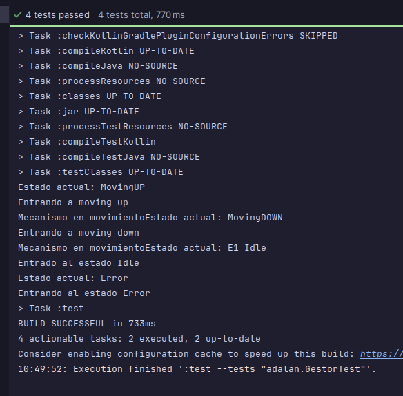

# Solución - Máquina de Estados "Halo de Vigo"


## Funcionamiento General
Esta máquina de estados controla de forma automatizada el funcionamiento del ascensor "Halo de Vigo", ya que se encarga de ir controlado como se encuentra  el ascensor, en que lugar se encuentra ahora mismo, si enta en movimiento o si ha sucedido algun error.

## TEST
foto de los tests


## Diagrama de Estados

aqui tengo un diagrama de los pasos que seguiria la maquina en cada caso 

```mermaid

stateDiagram-v2
[*] --> Idle
Idle --> MovingUP: Iniciar Subida (Nivel 0)
Idle --> MovingDOWN: Iniciar Bajada (Nivel 1)
MovingUP --> Idle: Llega a Plaza de Compostela (1)
MovingDOWN --> Idle: Llega a Av. G. Barbón (0)
Idle --> Error: Valor / Entrada no válida
MovingUP --> Error: Valor no válido
MovingDOWN --> Error: Valor no válido
Error --> Idle: Reset / Recuperación


